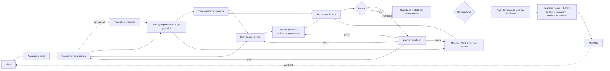
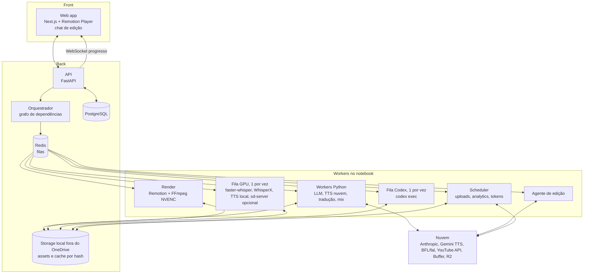

# Vulto: estúdio de vídeos sem rosto para YouTube

*Seu canal aparece. Seu rosto, não.* (antes chamado Videos Studio; marca e sistema visual em [docs/MARCA.md](docs/MARCA.md))

> Plataforma de **uso próprio** para **criar, editar por IA, publicar e gerenciar** vídeos "dark" (canais sem rosto) para **YouTube, Instagram Reels e TikTok**, em **formato longo (16:9)** e **Shorts/Reels (9:16)**, **multi-idioma**.

**Status:** v0.1 funcionando (roteiro, storyboard, prévia, render, edição por instrução, publicação no YouTube, agenda por canal) · **Última revisão:** 14/11/2026 · [Guia de uso](docs/USO.md) · [Estado atual](#140-estado-atual-14112026) · [Backlog](docs/BACKLOG.md)

## Começar agora

```powershell
powershell -ExecutionPolicy Bypass -File scripts\setup.ps1   # instala tudo (uma vez)
scripts\iniciar.cmd                                          # abre o app em http://127.0.0.1:8765
```

Sem nenhuma chave o app já funciona em **modo prévia** (roteiro de exemplo, voz do Windows, imagens procedurais). Para conteúdo real a custo zero, configure a chave grátis do **Gemini** em Configurações. Passo a passo completo em [docs/USO.md](docs/USO.md).

---

## Sumário

1. [Visão do produto](#1-visão-do-produto)
2. [Pesquisa: o que o mercado oferece](#2-pesquisa-o-que-o-mercado-oferece)
3. [Funcionalidades (escopo completo)](#3-funcionalidades-escopo-completo)
4. [Pipeline de produção](#4-pipeline-de-produção)
5. [Estilos: famílias, formatos e estilos próprios](#5-estilos-famílias-formatos-e-estilos-próprios)
6. [Edição incremental por instruções de IA](#6-edição-incremental-por-instruções-de-ia)
7. [Multi-idioma](#7-multi-idioma)
8. [Provedores: imagem, voz e vídeo no seu notebook](#8-provedores-imagem-voz-e-vídeo-no-seu-notebook)
9. [Treinamento / clonagem da sua voz](#9-treinamento--clonagem-da-sua-voz)
10. [Publicação, agendamento e redes sociais](#10-publicação-agendamento-e-redes-sociais)
11. [Arquitetura técnica](#11-arquitetura-técnica)
12. [Modelo de dados](#12-modelo-de-dados)
13. [Estrutura de pastas](#13-estrutura-de-pastas)
14. [Roadmap de implementação](#14-roadmap-de-implementação)
15. [Custos estimados](#15-custos-estimados)
16. [Riscos, políticas e conformidade](#16-riscos-políticas-e-conformidade)
17. [Decisões tomadas e perguntas em aberto](#17-decisões-tomadas-e-perguntas-em-aberto)
18. [Fontes da pesquisa](#18-fontes-da-pesquisa)

---

## 1. Visão do produto

Um estúdio que transforma **uma ideia** em **um vídeo publicado e agendado em várias redes e idiomas**:

```
Ideia → Roteiro → Voz → Cenas/visuais → Montagem automática → (ajustes por instrução de IA) → Thumbnail → SEO → Revisão → Agendamento → Publicação → Analytics
```

Princípios:

- **Edição automática, ajuste por conversa**: o vídeo sai montado. Para mudar algo, você dá uma instrução ("deixa a cena 5 mais sombria", "refaz o parágrafo 2 com mais tensão") e **só as partes afetadas são regeneradas** (§6).
- **Tudo configurável por estilo**: formato, duração, roteiro, voz, visual, edição, música, legendas e thumbnail ficam num **preset reutilizável** (§5).
- **Multi-idioma de verdade**: um projeto gera versões em vários idiomas, como vídeos separados ou como **várias faixas de áudio no mesmo vídeo** do YouTube (§7).
- **Cadeia de provedores com fallback**: cada etapa tem uma ordem configurável (ex.: imagens: Codex do seu plano → API barata → local). Quando um provedor esgota a cota ou falha, o próximo assume sozinho (§8).
- **Custo zero por padrão**: YouTube pela API oficial gratuita, TikTok e Instagram pelo plano grátis do Buffer, voz pelo Gemini TTS gratuito ou por modelos locais e imagens pelo seu ChatGPT Plus. Serviço pago só entra se um teste mostrar que vale a pena (§15).
- **Feito para um notebook**: o agendamento acontece **do lado da plataforma**, então o notebook pode estar desligado na hora de publicar. Os jobs pesados de GPU rodam um por vez (§8.6).
- **Humano no circuito**: portões de aprovação (roteiro, prévia, publicação), exigência prática da política de "conteúdo inautêntico" do YouTube (§16).
- **Nada se refaz à toa**: artefatos versionados, cacheados por hash e com custo registrado.

---

## 2. Pesquisa: o que o mercado oferece

### 2.1 Ferramentas de referência (para inspiração de features)

| Categoria | Ferramentas citadas com frequência | O que aproveitar como ideia |
|---|---|---|
| Geradores "tudo em um" | InVideo AI, Fliki, Pictory, AutoShorts.ai, Faceless.video | Fluxo prompt→vídeo, presets de nicho, postagem diária |
| Repurposing longo→curto | Opus Clip | Detectar trechos fortes de um longo e virar Shorts |
| Voz | ElevenLabs (v4, set/2026), Gemini 3.8 TTS, Qwen3-TTS, Applio/RVC | Clonagem, emoção, multilíngue |
| Imagem | ChatGPT Images 2.6 (via Codex), FLUX 3 Image Klein, Z-Image Turbo, Nano Banana 2.1 | Bíblia de estilo, referência de personagem |
| Vídeo IA | Veo 3.1, Kling, Runway, Seedance, Wan 3.0 (API) | Animar imagens-chave |
| Dublagem | Faixas multi-idioma e auto-dubbing do YouTube | Várias faixas de áudio no mesmo vídeo |
| Agendamento social | Buffer (grátis com API e MCP), Upload-Post, Ayrshare, Postiz | Uma API para várias redes |
| Open source | MoneyPrinterTurbo (MIT), AI-Faceless-Video-Generator (MIT) | Pipeline tema→roteiro→TTS→stock→legendas→render |

### 2.2 Conclusões que moldam o plano

1. **Ninguém faz edição incremental por instrução**: as ferramentas prontas regeneram o vídeo inteiro ou exigem timeline manual. Esse é o diferencial a construir (§6).
2. **Imagem local em 8 GB funciona, mas ainda perde para os modelos fechados**. No placar independente da Artificial Analysis, o melhor modelo aberto que roda em 8 GB e permite uso comercial (FLUX 3 Image Klein) tem Elo 1041; o GPT Image 2 tem 1192, e o Images 2.6, já disponível no Codex, ainda mais. Resultado: local serve como **reserva** para cenas, não como fonte principal (§8.3). **ComfyUI não é necessário.**
3. **O Codex no Plus gera imagens, mas não foi feito para lote**: não há cota de imagens publicada, imagens consomem o limite 3–5× mais rápido que texto e usuários relatam um teto diário oculto de ~100–330 imagens no Plus. A própria OpenAI indica API para lotes maiores (§8.2).
4. **Dá para ter voz grátis e legal para canal monetizado**: o **Gemini 3.8 Flash TTS** (Google AI Studio) tem camada gratuita, permite uso comercial e é o 6º colocado no placar de TTS (a ElevenLabs v4 é a 1ª). O Whisper não gera voz, só transcreve. Para a **sua** voz de graça há a clonagem local (Qwen3-TTS, Applio/RVC), mas a única avaliação independente em PT-BR achou a entonação "plana" em narração longa. Um teste cego decide (§8.4).
5. **Vídeo IA local em 8 GB não tem qualidade de produção**; fica em API, com movimento sintético (Ken Burns/parallax) nas imagens (§8.5).
6. **YouTube**: desde **2/11/2026** uploads de projetos de API não auditados **não ficam mais travados como privados**; desde 1/6/2026 o upload tem cota própria (100 por dia). Faixas de áudio multi-idioma continuam **sem API** e exigem recursos "avançados" do canal (§10.1).
7. **TikTok recusa apps de uso pessoal** na auditoria; sem auditoria, só posta como privado. **Instagram** dispensa App Review para contas próprias, mas posts de app em modo de desenvolvimento só aparecem para quem tem papel no app. Por isso **a v1 publica TikTok e Instagram pelo plano grátis do Buffer** (3 canais, com API e MCP), com o Upload-Post como reserva paga (§10.2).
8. **O YouTube desmonetiza conteúdo "intercambiável" e com cara de template no canal inteiro** (página oficial de políticas, renomeada para "conteúdo inautêntico" em 15/07/2025). Originalidade de roteiro e narração pesa mais que a fonte das imagens.
9. **Publicar por scraper ou agente de navegador viola os termos de uso** de TikTok, Instagram, YouTube e X, e as ferramentas que fazem isso quebram quase todo mês. O jeito legítimo de um agente de IA publicar é chamar APIs oficiais ou o MCP do Buffer (§10.2.1).

---

## 3. Funcionalidades (escopo completo)

Prioridade: **P0** = MVP · **P1** = primeira versão completa · **P2** = evolução

### 3.1 Canais
- **P0** Cadastro de canal: nicho, idioma(s), persona do narrador, público, estilos padrão, contas vinculadas e bíblia de estilo visual.
- **P1** Vários canais (ex.: canal PT, EN e ES do mesmo conteúdo).

### 3.2 Ideias e pesquisa
- **P1** Banco de ideias com status (backlog → aprovada → em produção → publicada).
- **P1** Gerador de ideias por LLM a partir do nicho e do histórico (sem repetir temas).
- **P1** **Assistente de escolha de nicho** (você ainda não decidiu): compara nichos por RPM estimado, concorrência, facilidade visual e potencial multi-idioma.
- **P2** **Outlier finder**: vídeos de concorrentes com views muito acima da média do canal.
- **P2** Sinais de tendência e ranking de ideias pelo desempenho de vídeos parecidos.

### 3.3 Roteiro
- **P0** Geração por LLM a partir de tema + estilo; a duração-alvo vira contagem de palavras (calibrada por idioma e voz).
- **P0** Roteiro em **segmentos com ID estável**, a base da edição incremental (§6).
- **P0** **Várias vozes no mesmo roteiro** (narrador + personagens/diálogos).
- **P0** Normalização para TTS: números e siglas por extenso; troca de estrangeirismos que a voz pronuncia mal.
- **P1** Estruturas de retenção: gancho em 3–5 s, *open loops*, re-ganchos nos longos e final em loop nos Shorts.
- **P1** Pesquisa e **checagem de fatos** com busca web; fontes anexadas ao roteiro.
- **P1** Verificador de similaridade com roteiros anteriores (anti-repetição).
- **P1** Capítulos automáticos → timestamps na descrição.

### 3.4 Narração e áudio
- **P0** TTS **por trecho curto** (1–3 frases), com prévia de 10 s.
- **P0** **Controle de qualidade automático**: cada trecho é transcrito de volta (faster-whisper) e regenerado se a taxa de erro passar do limite.
- **P0** Timestamps por palavra (do provedor ou alinhamento forçado com WhisperX).
- **P1** **Clonagem da sua voz** (§9).
- **P1** Música por "mood" com *ducking*; SFX automáticos; loudness ≈ −14 LUFS.
- **P1** **Narração multi-idioma** com a mesma voz (§7).

### 3.5 Visuais / cenas
- **P0** Storyboard automático: segmentos → cenas com prompt visual.
- **P0** Fontes por cena: **imagem IA** (cadeia de provedores, §8.1), **stock** (Pexels/Pixabay), **vídeo IA** ou **upload próprio**.
- **P0** Imagens geradas **sem texto**; todo texto (thumbnail, títulos na tela) é sobreposto por código, o que serve a todos os idiomas.
- **P1** Consistência visual: bíblia de estilo + imagens de referência de personagens.
- **P1** Image-to-video em cenas-chave (API); galeria de variações por cena.
- **P2** Parallax 2.5D por mapa de profundidade.

### 3.6 Montagem e edição
- **P0** Montagem 100% automática (storyboard + áudio + legendas + estilo de edição).
- **P0** Render 9:16 e 16:9 em 1080p, **por blocos**, para permitir re-render parcial (§6.5).
- **P0** Legendas karaokê queimadas, com fontes para todos os alfabetos (latino, cirílico, árabe/RTL, CJK, devanágari).
- **P1** **Edição por instrução de IA** com escopo e regeneração mínima (§6).
- **P1** Prévia no navegador, histórico de versões (desfazer, A/B, travar partes aprovadas).
- **P1** Intro/outro, marca d'água, barra de progresso, CTA animado.
- **P2** **Repurposing**: Shorts/Reels gerados a partir de trechos de um longo.
- **P2** Exportar o projeto para editor externo (FCPXML/EDL para DaVinci/Premiere).

### 3.7 Thumbnail e SEO
- **P1** Thumbnail: imagem base + texto sobreposto por template, 3 variações e versão por idioma.
- **P1** Títulos, descrição com capítulos, tags, hashtags, comentário fixado, playlist, **tudo por idioma e adaptado por rede**.
- **P1** Legendas SRT enviadas como closed caption em cada idioma.

### 3.8 Revisão e qualidade
- **P0** Portões de aprovação: roteiro → prévia → publicação.
- **P1** Checklist automático antes de publicar: duração (Shorts ≤ 3 min), loudness, sincronia, tela preta, flags de IA por plataforma, licenças de assets, sincronia de cada faixa de idioma e limites de cada rede.

### 3.9 Publicação e redes
Ver §10. **v1: YouTube + Instagram Reels + TikTok.** Depois: Threads, Facebook e X.

### 3.10 Operação
- **P0** Fila de jobs com progresso em tempo real, *retry* e retomada.
- **P0** Cofre de credenciais criptografado.
- **P0** **Custo por vídeo e por edição**, com prévia antes de aplicar.
- **P0** **Cadeia de provedores com fallback automático** e registro de qual provedor gerou cada asset.
- **P1** Medidores de cota: YouTube (100 uploads/dia por projeto), limites por rede e uso do Codex.
- **P1** Biblioteca de assets com **licença registrada por item**.
- **P2** **Séries / piloto automático** até o portão de revisão.

---

## 4. Pipeline de produção



Cada caixa é um **job idempotente** que grava artefatos versionados. Um **orquestrador** olha o grafo de dependências e roda apenas o que está desatualizado (§6.3).

---

## 5. Estilos: famílias, formatos e estilos próprios

**Resposta curta:** sim. O app produz vídeos em vários estilos (motion graphics, tipografia animada, parallax 2.5D, documentário de arquivo, VHS/analog horror, mapas animados, colagem e outros) e permite **criar estilos próprios sem programar**. Boa parte dos "looks" já vem pronta no Remotion: **21 transições** e **~90 efeitos** (grão, LUT, vinheta, scanlines, sinal de TV fora do ar, estática, queima de filme, halftone, duotone, papel, bordas rasgadas, pixelização, chuva/neve e mais).

### 5.1 Três eixos independentes

| Eixo | O que define | Exemplos |
|---|---|---|
| **Arte** | Como as imagens são: técnica, paleta, traço, luz | pintura a óleo sombria, gravura, foto antiga, noir, HQ, anime, aquarela, vetor flat, pixel art, argila 3D |
| **Edição** | Como o vídeo se move e é montado: família visual, câmera, cortes, transições, efeitos, legendas, áudio | documentário Ken Burns, motion graphics, VHS |
| **Formato** | A estrutura da narrativa | Top 10, iceberg, tier list, quiz, linha do tempo, "a história de X em 10 minutos", série |

Qualquer combinação vale: por exemplo, um Top 10 (formato) em motion graphics (edição) com arte de gravura antiga.

### 5.2 Famílias de estilo

| # | Família | Estilos que ela cobre (nomes que você vai ver por aí) | Como o app produz | Quando |
|---|---|---|---|---|
| 1 | **Cinema de imagens paradas** | Ken Burns ("slideshow com zoom"), **parallax 2.5D** ("foto 3D", "efeito History Channel"), documentário de arquivo, pinturas clássicas | Movimento de câmera no Remotion; parallax com mapa de profundidade (Depth Anything, só modelos Apache) | v1 (parallax: v1.5) |
| 2 | **Motion graphics editorial** | **motion graphics**, vídeo-ensaio "estilo Vox", **tipografia cinética**, texto em fundo preto, zoom em jornal e documentos, **quadro de investigação com barbante vermelho** | Componentes Remotion (formas, caminhos, texto animado, Lottie) | v1 |
| 3 | **Dados e geografia** | infográficos, gráficos animados, corrida de barras, **mapas animados**, **globo 3D**, linha do tempo, comparação de tamanho | D3, MapLibre (tiles OpenFreeMap/Protomaps), three-globe com Natural Earth e texturas da NASA | v1.5 |
| 4 | **Ilustrado 2D** | explainer **flat** "estilo Kurzgesagt", **whiteboard** ("mão desenhando"), **bonecos palito**, HQ animada (motion comic), anime, pixel art, isométrico | Imagens IA consistentes + revelação por traço, vetorização (vtracer), animação de recortes | depois |
| 5 | **Textura artesanal** | **colagem / recorte de papel**, mixed media, look de massinha (claymation), rotoscopia | Recorte de objetos (BiRefNet), efeitos de papel/halftone/bordas, stop motion com tremor controlado | v1.5 |
| 6 | **3D e simulação** | render 3D low-poly, dioramas isométricos, texto 3D, animação matemática "estilo 3Blue1Brown" | three.js no Remotion; Manim (MIT) para matemática; Blender só para cenas pesadas | depois |
| 7 | **Analógico e atmosfera** | **VHS**, **glitch**, **analog horror**, espaços liminares/backrooms, lo-fi | Efeitos prontos: scanlines, sinal de TV, estática, aberração cromática, queima de filme, LUT | v1 |
| 8 | **Interface de tela** | histórias de conversa (estilo WhatsApp), "screenlife" (gravação de tela), HUD | Componentes de interface próprios, sincronizados com a narração | depois |
| 9 | **Vídeo IA** | cinematográfico com IA (image-to-video) | Poucos planos-chave via fal.ai (Kling, MiniMax), partindo de imagens do próprio estilo | v1 (opcional, pago) |

Vídeos longos misturam **2–3 famílias** (ex.: documentário de arquivo + motion graphics nos dados + glitch nas viradas).

### 5.3 Formatos estruturais

Uma camada aplicada sobre qualquer família: **Top 10/ranking** (contador), **iceberg** (níveis do mais conhecido ao mais obscuro), **tier list**, **quiz/trivia**, **"você prefere"**, **linha do tempo**, **"a história de X em N minutos"**, **POV** e **séries** com personagem recorrente. O formato define a estrutura do roteiro e os cartões de seção.

### 5.4 Especificação de estilo (StyleSpec)

Um estilo é um **dado validado**, não código novo a cada vídeo. O mesmo esquema valida o estilo no backend (Pydantic) e no renderer (Zod). Exemplo:

```yaml
id: misterios-short
name: "Mistérios Sombrios: Short"
family: still_cinema                  # família principal (§5.2)
families_mix: [still_cinema, analog]  # longos misturam 2–3 famílias
structure: none                       # top10 | iceberg | tierlist | quiz | timeline | ...

format:
  type: short                         # short | long
  aspect: "9:16"
  resolution: 1080x1920
  fps: 30
  duration: { target_s: 55, min_s: 40, max_s: 59 }   # Shorts do YouTube: até 3 min

languages:
  primary: pt-BR
  outputs: [pt-BR, en-US, es-ES]
  delivery: separate_videos           # separate_videos | multi_audio_track (§7)

script:
  tone: "suspense, sussurrado, frases curtas"
  structure: [hook_pergunta, contexto, 3_revelacoes, twist, cta_loop]
  hook_max_s: 3
  fact_check: true
  speakers:
    narrator: { voice_profile: "minha-voz" }

voice:
  chain: [gemini_tts_free, chirp3hd_free, qwen3_tts_local]   # ordem de fallback, custo zero
  voice_profile: "minha-voz"
  timbre: { rvc_model: "minha-voz-rvc", enabled: false }      # opcional (§9)

art:                                  # eixo de arte
  bible: "pintura a óleo sombria, paleta #0b0f14 #3a4a5a #c9a227, luz de vela, grão de tela"
  banned: ["texto", "logotipos", "fotorrealismo"]
  anchors: []                         # 3–8 imagens aprovadas que fixam o estilo
  image_chain: [codex_cli, flux3_klein_api, local_sdcpp]
  thumbnail_chain: [codex_cli, gpt_image_api]

edit:                                 # eixo de edição
  shot_seconds: { min: 1.8, max: 3.2 }
  camera: { ken_burns_in: 3, ken_burns_out: 2, pan_left: 1, punch_zoom: 1 }   # pesos sorteados por cena
  transitions: { cut: 6, flash: 1, glitch: 1 }
  effects:
    - { type: grain, amount: 0.35 }
    - { type: vignette, amount: 0.5 }
    - { type: grade, preset: cold-teal-dark }
  captions:
    style: karaoke
    font: "Montserrat ExtraBold"      # fallback Noto para outros alfabetos
    size: 78
    color: "#FFFFFF"
    highlight: "#FF2E2E"
    stroke: 6
    position: center
    max_words_per_line: 3
  progress_bar: true
  watermark: "logo-canal.png"

audio:
  music: { source: procedural, mood: "dark ambient drone", volume_db: -22, ducking: true }
  sfx: { auto: true, pack: "horror-basic" }
  loudness_lufs: -14

thumbnail: { template: "texto-grande-esquerda", variations: 3, per_language: true }

variation:
  seed_scope: video                   # sementes por vídeo e por cena
  avoid_repeat_last: 5                # não repetir a mesma combinação nos últimos 5 vídeos

publish:
  targets:
    - { platform: youtube,   driver: youtube_native, privacy: public, schedule: best_time }
    - { platform: tiktok,    driver: buffer }
    - { platform: instagram, driver: buffer }
  ai_label: auto                      # mapeado por plataforma (§10.4)
```

**Regras técnicas que vieram da pesquisa:**
- Todos os pacotes `remotion` e `@remotion/*` ficam **fixos na mesma versão exata** (hoje 4.0.543).
- Os efeitos do Remotion só se aplicam a camadas de **imagem, vídeo e cor sólida**. Por isso ficam nas imagens; legendas e textos têm estilo próprio. Assim a prévia funciona em qualquer navegador.
- Transições que **encurtam o vídeo** (sobreposição de cenas) são evitadas. Flashes, vazamentos de luz e glitches entram como *overlay*, sem mudar a duração da narração.
- Toda variação usa **sementes fixas por cena** (`random(seed)`), para que um re-render parcial combine com os blocos vizinhos.
- Mudanças como "mais escuro" ou "mais quente" são **parâmetros de cor no Remotion**, sem nova chamada de IA. Mudanças de conteúdo usam **edição da imagem existente** com as âncoras do estilo.
- WebGL (3D, mapas) renderiza com `--gl=angle`; o NVENC é ativado com `--hardware-acceleration if-possible`.

### 5.5 Criar estilos próprios (quatro níveis)

1. **Formulário**: duplicar um preset e ajustar os parâmetros, com prévia instantânea.
2. **Descrição em texto**: você escreve, por exemplo, "documentário sombrio de jornal antigo, lento, sépia, texto de máquina de escrever". O LLM (Gemini grátis) devolve um *patch* do StyleSpec, que é validado, mostrado como diferença e pré-visualizado, com até 3 tentativas de correção automática.
3. **A partir de um vídeo de referência** (seu ou licenciado; um link público do YouTube serve para a parte de descrição). O app **mede**:
   - ritmo de cortes (TransNetV2 para Shorts, PySceneDetect para longos);
   - paleta (k-means);
   - ritmo da música (librosa) e velocidade da narração (faster-whisper);
   - posição e estilo das legendas (OCR);
   - linguagem visual, descrita pelo Gemini.

   Guarda só **parâmetros**, nunca os arquivos, e marca cada valor como "medido" ou "inferido". Recomendação: misturar referências em vez de copiar um criador.
4. **Style Lab (componentes novos por IA)**: para um look que não existe (ex.: "quadro de evidências com fotos presas por alfinetes"), o Codex com as **Agent Skills oficiais do Remotion** escreve um componente novo. Ele só entra na biblioteca depois de passar pelos portões automáticos:
   - compilação TypeScript;
   - lint: sem acesso à rede, sem `eval`, só imports permitidos;
   - render de teste em 16:9 e 9:16;
   - checagem de quadro vazio e de área segura;
   - a sua aprovação.

   Isso é feito **uma vez no Style Lab**, nunca a cada vídeo.

**Pacotes de estilo:** um `.zip` com `style.json`, componentes opcionais (revalidados ao importar) e assets com **licença registrada por item**: fontes OFL com o texto da licença, animações Lottie da LottieFiles, e LUTs e SFX só se a redistribuição for permitida. Nada não comercial entra em pacotes usados em canal monetizado.

### 5.6 Variação anti-repetição e presets bloqueados

- **Sementes por vídeo e por cena** dentro da identidade do canal, 2–3 famílias por vídeo longo e rotação de vinhetas, cartões de título, **thumbnails e padrões de título**. Os revisores do YouTube olham também metadados e thumbnails.
- **Verificador de novidade**: compara impressões digitais visuais (imagehash/CLIP) do novo vídeo com as dos últimos e avisa quando está parecido demais.
- Variação visual **não basta**: o YouTube julga **substância**. Roteiro, ângulo e pesquisa precisam variar de vídeo para vídeo.
- Prefira **IA estilizada** (pintura, gravura, HQ) a fotorrealista: exige menos rótulo e tem menos cara de "conteúdo de IA em massa". O YouTube permite explicitamente "usar IA para visualizar um personagem único".
- **Presets bloqueados em canais monetizados** (alto risco de desmonetização ou remoção):
  - histórias do Reddit sobre gameplay;
  - micro-dramas com animais ou objetos falantes;
  - "brainrot";
  - trailers falsos;
  - personas de IA dando conselho de saúde, finanças ou direito;
  - true crime ou história **inventados** apresentados como reais.

### 5.7 Presets de nicho (ponto de partida; você escolhe depois)

| Preset | Formato | Famílias | Arte | Edição |
|---|---|---|---|---|
| Documentário sombrio / história | Longo 10–20 min | 1 + 2 | pintura a óleo, gravura, foto antiga | Ken Burns lento, grão, vinheta, cartões de capítulo |
| Mistérios / curiosidades | Short 40–59 s | 1 + 7 | pintura sombria | cortes a cada 1,5–2,5 s, punch zoom, karaokê, glitch nas viradas |
| Terror / analog horror | Longo e Short | 7 + 1 | foto noturna granulada, liminal | VHS, estática, sinal de TV, sussurros, várias vozes |
| True crime | Longo 15–30 min | 2 + 1 | noir, documentos | zoom em documentos, quadro de evidências, linha do tempo |
| Top 10 / listas | Longo 8–12 min | 2 + 1 | variada | contador animado, título por seção |
| Motivacional / estoico | Short | 1 + 2 | pinturas clássicas, mármore | tipografia cinética, letreiro grande |
| Explicador de dados | Longo | 3 + 2 | vetor flat | gráficos, mapas, comparação de tamanho (v1.5) |

## 6. Edição incremental por instruções de IA

O **núcleo** do produto: você não edita numa timeline; você **pede**, e o sistema muda **só o necessário**.

### 6.1 Exemplos

| Instrução | O que é regenerado | O que é reaproveitado |
|---|---|---|
| "Cena 7 mais sombria, com névoa" | 1 imagem + 1 bloco de render | Todo o resto |
| "Refaz o parágrafo 2 com mais tensão" | Trechos de narração do parágrafo (nos idiomas afetados) + legendas + blocos do trecho | Imagens e outros trechos |
| "Encurta a intro em 5 s" | Texto e narração do gancho; timing das cenas 1–3 | Imagens das cenas 1–3 |
| "Troca a música a partir de 2:10" | Mix de áudio | Narração, imagens, vídeo (só re-mux) |
| "Legendas maiores no vídeo todo" | Camada de legendas dos blocos | Áudio, imagens |
| "Em espanhol a voz está rápida" | Narração ES + mix ES | Vídeo e outros idiomas |
| "Personagem X mais velho em todas as cenas" | Imagens dessas cenas | Demais cenas |
| "Gera outra versão do gancho" | Ramo novo só com o gancho | Resto do projeto compartilhado |

### 6.2 Projeto como documento estruturado

Todo vídeo é um **documento de projeto** (`project.json`) com **IDs estáveis**:

```jsonc
{
  "id": "prj_123",
  "style": "misterios-short@v4",
  "segments": [
    { "id": "seg_01", "speaker": "narrator", "text": { "pt-BR": "...", "en-US": "..." }, "locked": false }
  ],
  "scenes": [
    { "id": "scn_07", "segments": ["seg_04"],
      "visual": { "type": "ai_image", "prompt": "...", "asset": "ast_88", "provider": "codex_cli", "seed": 42 },
      "motion": "ken_burns_in", "transition_in": "flash_white", "locked": true }
  ],
  "audio": { "music_cues": [ { "id": "mus_1", "from": "seg_01", "mood": "drone" } ], "sfx_cues": [] },
  "overrides": {}
}
```

### 6.3 Grafo de dependências + cache por hash

Cada artefato (trecho de narração, imagem, bloco de render, mix) é um **nó** com **hash das entradas** (texto, prompt, provedor, modelo, seed, parâmetros e hashes dos nós de que depende).

```
segmento(texto, voz) ──► narração(trecho, idioma) ──► timestamps ──► timing das cenas ─┐
cena(prompt, seed) ──► imagem ──► [clipe de vídeo] ───────────────────────────────────┼─► bloco de render ──► vídeo final
estilo de legenda ────────────────────────────────────────────────────────────────────┘                      ▲
narrações + música + SFX ──► mix por idioma ─────────────────────────────────────────────────────────────────┘ (mux)
```

Só nós com hash novo são regenerados. Mudanças de timing apenas deslocam blocos: o bloco é identificado pelo conteúdo, não pela posição.

### 6.4 Agente de edição (otimizado em tokens)

- Um LLM com *tool use* (Claude) recebe **um resumo compacto** do projeto (1 linha por segmento/cena) e busca detalhes sob demanda.
- Ferramentas tipadas: `get_outline`, `get_segment`, `get_scene`, `update_segment_text`, `update_scene_prompt`, `regenerate_asset`, `set_scene_duration`, `split_scene`, `merge_scenes`, `reorder_scenes`, `set_music_cue`, `set_caption_style`, `apply_style_override`, `translate_segment`, `create_branch`.
- Retorna um **patch**, um resumo e uma **estimativa de custo e tempo**: "Vou regenerar 1 narração (PT) e 2 imagens (Codex); ≈ US$ 0,02; ≈ 2 min. Aplicar?"
- **Escopo explícito** (cena, trecho de tempo clicado na prévia, idioma), **travas** (`locked`) e **memória de preferências** (correções repetidas viram sugestão de mudança no estilo).

### 6.5 Técnicas que evitam refazer tudo

| Problema | Técnica |
|---|---|
| Regerar um trecho de narração sem destoar | TTS por trecho com contexto anterior/seguinte (`previous_text`/`next_text` na ElevenLabs) e mesmo prompt de clonagem; emenda em pausa natural com crossfade |
| Re-render de 15 min por causa de uma cena | **Render por blocos** (cortes secos, ~10–30 s), concat no FFmpeg sem re-encode |
| Trocar música/volume | Áudio mixado à parte; só re-mux |
| Imagem nova destoando | Prompt-base da bíblia de estilo + seed + imagem de referência |
| Perder uma versão boa | Cada instrução é um **commit**: desfazer, A/B, ramos |

---

## 7. Multi-idioma

Suporte a **todos os principais idiomas** que os provedores de voz cobrem (ElevenLabs v4: 90+; os modelos locais cobrem bem menos), com **dois modos de entrega**.

### 7.1 Fluxo de tradução
1. Roteiro aprovado no idioma principal.
2. Tradução **por segmento** (LLM) com glossário do canal, adaptação cultural e **meta de duração por segmento**.
3. Revisão opcional por idioma, com retrotradução automática para conferência.
4. Narração com a **mesma voz clonada** ou uma voz nativa da biblioteca.
5. Legendas, título, descrição, tags e thumbnail traduzidos.

### 7.2 Modo A: um vídeo por idioma (`separate_videos`)
- Render próprio por idioma (timing, legendas queimadas e textos traduzidos).
- Canais separados ou o mesmo canal; **é o único modo possível no Instagram e no TikTok** (não têm faixas de áudio alternativas).
- Totalmente automatizável. Atenção: todos os canais ligados ao mesmo projeto do Google Cloud **dividem os 100 uploads/dia**.

### 7.3 Modo B: várias faixas de idioma no mesmo vídeo (`multi_audio_track`, só YouTube)
O YouTube aceita faixas de áudio dubladas no mesmo vídeo, somando views e inscritos num vídeo só. Restrições:

- **Exige recursos "avançados" do canal** (verificação por documento/vídeo ou histórico do canal). Um canal novo pode não ter acesso no início.
- **Sem API**: o envio é feito no YouTube Studio (Idiomas → Adicionar idioma → Dublagem). O app gera o **pacote pronto** por idioma (áudio WAV mixado, SRT, título, descrição) e um checklist com links diretos.
- A imagem é a mesma em todos os idiomas: **nada de texto queimado** (legendas viram faixas de closed caption via `captions.insert`) e imagens sem texto.
- **A faixa precisa ter praticamente a mesma duração do vídeo**: tradução com orçamento de duração, ajuste de velocidade do TTS e *time-stretch* leve (até ±8–10%); o idioma mais longo define o tempo de cada segmento.
- Títulos, descrições e legendas por idioma vão pela API (`localizations`, `captions.insert`).
- Alternativa gratuita: o auto-dubbing do YouTube, que usa a voz do YouTube e não a sua.

### 7.4 Detalhes técnicos
- Fontes Noto com fallback por alfabeto; RTL nas legendas.
- Palavras/minuto calibradas por idioma; dicionário de pronúncia por idioma.
- Alinhamento forçado por idioma (WhisperX; para PT usar `jonatasgrosman/wav2vec2-large-xlsr-53-portuguese`, Apache-2.0; **evitar** o modelo MMS padrão do ctc-forced-aligner, que é não comercial).

---

## 8. Provedores: imagem, voz e vídeo no seu notebook

**Seu hardware:** Samsung Galaxy Book3 Ultra, i9-13900H, **RTX 4070 Laptop com 8 GB e TGP de 60 W** (35 W garantidos + 25 W de Dynamic Boost, que somem quando a CPU está ocupada) e 32 GB de RAM. Na prática a GPU rende como uma RTX 4050/4060 de notebook.

| Etapa | Cadeia padrão (ordem de fallback) | Observações |
|---|---|---|
| Roteiro, tradução, agente | Só o Claude pela conta (Claude Code `claude -p`, plano Pro/Max) | Sem custo extra: usa os limites do plano. API paga e Gemini (texto) retirados em 14/11/2026 |
| Pesquisa de fatos | LLM + busca web (Tavily/Brave/Exa) | Fontes salvas no roteiro |
| **Imagens de cena** | **Codex (seu Plus)** → procedural (só prévia); Pexels opcional. FLUX, fal.ai e OpenAI Images retirados em 14/11/2026 | §8.1–8.3 |
| **Thumbnails** | **Codex (seu Plus)** → API OpenAI (`gpt-image-2.6-flare`) ou Nano Banana 2.1 | Texto sempre sobreposto por código |
| **Narração** | **Gemini 3.8 Flash TTS (grátis)** → Chirp 3 HD (1 M caracteres grátis/mês) → Qwen3-TTS local; ElevenLabs só se o teste cego justificar | §8.4 |
| QA da narração / timestamps | faster-whisper large-v3-turbo int8 + WhisperX (local, ~1,5–3 GB) | Roda bem na sua GPU |
| Vídeo IA | fal.ai (Kling, Veo, Seedance) → Ken Burns/parallax | §8.5 |
| Stock | Pexels, Pixabay | Licença por asset |
| Música / SFX | Biblioteca própria licenciada → ElevenLabs Music/SFX | Content ID ainda pode reivindicar |
| Render | Remotion + FFmpeg (NVENC) | Local |

### 8.1 Estratégia de imagens (sua resposta: Codex local)

- **Codex é a fonte principal**, como você pediu, usando a cota do ChatGPT Plus. Na prática você usa o modelo de imagem atual do ChatGPT (a OpenAI diz que o Images 2.6, de 04/11/2026, está no Codex; a documentação ainda cita gpt-image-2).
- Como a cota do Plus é **limitada e não publicada**, a cadeia continua sozinha quando ela acaba:
  1. **Codex** (sem custo extra) até receber `usage_limit_reached`, 429 ou timeout;
  2. **FLUX 3 Image Klein via API da BFL**: ~US$ 0,009 por imagem 1K, sem cobrança em falhas e moderação. Alternativas: Z-Image Turbo no fal (~US$ 0,005/MP) e Nano Banana 2.1 (~US$ 0,034);
  3. **Local** (opcional, §8.3) para lotes noturnos de cenas.
- **Thumbnails** vão sempre para o melhor modelo disponível (Codex; na falta dele, API da OpenAI a ~US$ 0,04–0,05 por imagem), porque são poucas e decisivas para o CTR.
- **Não comprar créditos do Codex para imagens**: custam o mesmo que a API da OpenAI (~US$ 30 por 1M tokens de saída), 3–10× mais que FLUX Klein ou Z-Image.
- **Não fixar nome de modelo no código**: em 2026 os modelos de imagem foram aposentados a cada 2–3 meses (`gpt-image-2` na API foi depreciado em 10/11/2026 e desliga em 10/02/2027; `gpt-image-1.5` e `gpt-image-1-mini` desligam em 01/12/2026).

### 8.2 Como o adapter `codex_cli` funciona (validar na Fase 0)

- Chamada não interativa com `codex exec --json --sandbox workspace-write --skip-git-repo-check --ephemeral` e `approval_policy = "never"`. O `--full-auto` **não existe mais**.
- **Um job por vez, uma imagem por chamada**, com prompt pedindo explicitamente a geração (`$imagegen`).
- `config.toml` com `forced_login_method = "chatgpt"`, e **sem** `OPENAI_API_KEY`/`CODEX_API_KEY` no ambiente, para nunca cair em cobrança por API sem você saber.
- **Detectar a saída pelo sistema de arquivos**: novas imagens em `%USERPROFILE%\.codex\generated_images\`. Há relato de `exit 0` sem a imagem, e a geração não emite evento próprio no `--json`. Validar o PNG e aplicar timeout de 6–8 min (no Windows há relatos de corte em ~300–350 s).
- **Tamanhos válidos** (múltiplos de 16): pedir 1536×864 ou 1088×1920/1152×2048 e recortar localmente. 1080×1920 é inválido.
- Medidor de uso diário e "esfriamento" automático ao bater o limite. A cota pode ser **compartilhada com o ChatGPT web**: gerar imagens no site consome a mesma reserva.
- **Termos de uso**: a OpenAI documenta automação com login do ChatGPT, mas diz que "o jeito certo" de automatizar é com chave de API e manda lotes maiores para a API. Para uso pessoal, de baixo volume, uma conta e sem paralelismo, é tolerado, mas não garantido. Reler as Políticas de Uso que entram em vigor em 20/11/2026.
- Checar o build do Windows (`winver`): o sandbox MXC exige 26200.9278 ou superior; senão, usar o sandbox `elevated`.

### 8.3 Imagem local: vale a pena? (sua pergunta sobre ComfyUI)

**Resposta curta: não use ComfyUI.** A qualidade local em 8 GB está boa, mas abaixo do Codex. E dá para rodar localmente **sem ComfyUI**, se um dia quiser.

| Modelo (licença) | Cabe em 8 GB? | Velocidade estimada no seu notebook | Qualidade (Elo AA) | Uso no canal monetizado |
|---|---|---|---|---|
| **FLUX 3 Image Klein** (FLUX Kommunity: comercial OK abaixo de US$ 5M/ano) | Sim (GGUF Q6/Q8 ou INT8 + offload) | ~35–45 s/imagem (medido: 36 s numa 4060 Laptop) | **1041**, o melhor aberto viável | Sim, com revisão humana; a BFL pode revogar a licença |
| **Z-Image Turbo** (Apache-2.0) | Sim (FP8/INT8/GGUF) | ~8–20 s/imagem | 937 | Sim, sem amarras |
| FLUX.2 klein 4B (Apache-2.0) | Sim | rápido (4 passos) | 840 | Sim, mas fraco |
| Qwen-Image-2.1 / FLUX.2 klein 9B / FLUX.1 dev | — | — | — | **Não** (licença não comercial) |
| *Referência:* GPT Image 2 (high) / Images 2.6 | nuvem | — | 1192 / 1210–1261 | Sim |

- Contra o modelo do Codex, o FLUX 3 Klein venceria só **~20–30% das comparações às cegas**.
- **Uso recomendado**: **reserva opcional** para imagens de cena em lote noturno, ativada só se um **teste cego com 20–30 prompts do seu nicho** mostrar que a diferença some depois do movimento, da gradação de cor e do upscale.
- **Runtime sem ComfyUI**: `stable-diffusion.cpp` (`sd-server.exe`, MIT, builds Windows CUDA 12), rodando como serviço local com API HTTP (inclusive compatível com `/v1/images/generations`). Fixar um build específico, porque são releases contínuas.
- Treinar LoRA de personagem em 8 GB só funciona em 512 px e devagar; se precisar, alugar uma GPU por algumas horas.
- Ajuste do driver NVIDIA: "CUDA – Sysmem Fallback Policy" = **Prefer No Sysmem Fallback**, para estouro de VRAM dar erro em vez de ficar lento sem aviso.

### 8.4 Voz com custo zero

**Whisper não gera voz.** O Whisper (e o faster-whisper/WhisperX) faz **transcrição** (fala → texto). Ele continua no plano, de graça e local, para legendas, timestamps por palavra e para conferir cada trecho narrado. O único TTS derivado dele (WhisperSpeech) é só em inglês e parou em 2024.

**"Voice Studio"** pode ser duas coisas:
- O **app VoiceStudio** (GitHub, Windows): o motor padrão dele (OmniVoice) tem pesos **não comerciais** (CC-BY-NC) e não pode ser usado em canal monetizado. O app só serve como lançador de motores com licença comercial e português (VoxCPM2, MOSS-TTS, dots.tts).
- A geração de voz do **Google AI Studio** (Gemini TTS): é o melhor caminho gratuito (tabela abaixo).

| Opção | Custo | Uso comercial | PT-BR | Clonagem | Observações |
|---|---|---|---|---|---|
| **Gemini 3.8 Flash TTS** (AI Studio / Gemini API) | **Grátis** (camada free) | Sim (o Google não reivindica a saída) | Sim | Só no plano pago (Tier 1+) | 6º no placar de TTS (Elo 1284; ElevenLabs v4: 1340). Limite diário não publicado (relatos: 10–100 pedidos/dia por modelo; cada pedido gera até ~10 min de áudio). Na camada grátis os textos podem ser usados para treino e lidos por revisores humanos |
| Gemini 3.8 Flash-Lite TTS | Grátis | Sim | Sim | — | Segunda cota diária, separada |
| **Google Cloud TTS Chirp 3 HD** | **1 M caracteres grátis/mês** | Sim (uso em mídia permitido) | Sim | Não (voz personalizada é paga) | Exige cobrança ativada (projeto separado, com alerta de orçamento); qualidade abaixo do Gemini |
| **Kokoro-82M local** (`kokoro-onnx`) — **voz da prévia** | Grátis | Sim (Apache-2.0) | Sim (3 vozes) | Não | CPU, ~2,5× mais rápido que a fala; no teste com o Whisper leu o roteiro sem erro. Qualidade abaixo das APIs: usada só para conferir o conteúdo antes de gravar a voz final |
| **Qwen3-TTS 1.7B local** (`faster-qwen3-tts`) | Grátis | Sim (Apache-2.0) | Sim | **Sim, zero-shot** (3 s + transcrição) | ~1,8× tempo real numa 4060 no Windows; avaliação PT-BR independente: entonação "plana" em narração longa |
| VoxCPM2 / MOSS-TTS / dots.tts locais | Grátis | Sim (Apache-2.0) | Sim | Sim | Mais apertados em 8 GB (dots.tts: só a variante MF e trechos < 40 s) |
| Gemini pago (Batch) | ~US$ 0,5–2,4/mês para 10–15 longos | Sim | Sim | Sim (com gravação de consentimento em PT-BR) | Reserva barata se a cota grátis apertar |
| ElevenLabs Creator | US$ 22/mês | Sim | Excelente | IVC e PVC | Fica como **referência** no teste cego |
| Azure F0, edge-tts, ElevenLabs Free, Murf/Speechify Free | — | **Não** | — | — | Azure: direito comercial só no plano pago. edge-tts: imita o cliente do Edge com token obtido por engenharia reversa. Planos grátis: uso não comercial |

**Plano:**
1. **Fase 0: teste cego** com 2–3 roteiros reais de 10–15 min em PT-BR:
   - Gemini 3.8 Flash × Flash-Lite × Chirp 3 HD;
   - Qwen3-TTS com a sua voz clonada × Gemini + RVC com a sua voz (§9);
   - **você lendo**, como âncora;
   - ElevenLabs só como referência (o plano de US$ 6 por um mês basta para o teste).

   Critério: ficar a até ~0,5 ponto (escala de 1 a 5) da referência, menos de 5% de trechos falhos depois de retry e um vídeo de 15 min em menos de ~1 h.
2. **Prévia com a voz local (Kokoro) e voz final só na renderização** (14/11/2026): a prévia não gasta cota de voz, e o vídeo final nunca cai para uma voz de teste (sem a voz final disponível, a renderização para e avisa). Cadeia da voz final até o teste dizer outra coisa: **Gemini Flash TTS → Flash-Lite → Chirp 3 HD → Qwen3-TTS local**. Usar **um único** projeto do Google para a cota grátis: criar vários projetos para multiplicar a cota viola os termos do Google.
3. Reservar ~25% da cota diária para as regenerações apontadas pelo QA do Whisper.
4. Regras do pipeline: trechos curtos (até ~700 caracteres, porque os modelos degradam com textos longos), mesmo prompt de clonagem em todos os trechos, QA por ASR (taxa de erro e duração esperada) e normalização de números e estrangeirismos.
5. Usar só os modelos Gemini 3.8 em diante: os TTS 2.5 e 3.1 preview podem ser desligados a partir de 18/12/2026.
6. Para as versões em inglês e espanhol dos longos, testar também a **dublagem automática gratuita do YouTube**.

### 8.5 Vídeo IA
- **Local não é viável para produção** em 8 GB/60 W: Wan 2.2 5B a 720p pede 24 GB; HunyuanVideo 1.5 pede 14 GB; o LTX-2.5 é enorme. Experimentos com Wan2GP a 480p levam ~2 min por clipe de 2–3 s, com muitos descartes.
- **Produção**: fal.ai (Kling, Veo, Seedance) só em cenas-chave + **Ken Burns/parallax** nas imagens.

### 8.6 Regras de operação do notebook
- Jobs pesados **ligado na tomada**, no modo de desempenho da Samsung.
- **Um job de GPU por vez** (TTS, ASR, imagem local) e **sem render FFmpeg em paralelo**: CPU ocupada rouba o Dynamic Boost da GPU.
- Desligar a aceleração de GPU do navegador durante lotes (libera VRAM).
- Agendamento **sempre do lado da plataforma** (YouTube `publishAt`, fila do Buffer, agendadores nativos), com os vídeos no R2, para publicar com o notebook desligado.
- Pasta de mídia/cache **fora do OneDrive** (ex.: `D:\VideosStudioData`).

---

## 9. Treinamento / clonagem da sua voz

### 9.1 Caminhos (do mais barato ao mais caro)

| Caminho | Custo | Áudio seu necessário | Qualidade esperada | Observações |
|---|---|---|---|---|
| **Você mesmo narra** | Grátis (só um microfone USB) | — | **A melhor entonação** | O clone fica para correções, Shorts e outros idiomas |
| **Qwen3-TTS zero-shot** (local) | Grátis | 3–30 s + transcrição | Timbre muito próximo; pode soar plano em textos longos | Apache-2.0; roda na sua GPU |
| **TTS bom + Applio/RVC** (local) | Grátis | 10 min (mínimo) a 30 min (ideal) | Entonação do TTS de origem (ex.: Gemini) com o **seu timbre** | O RVC só troca o timbre; treino de algumas horas na sua GPU |
| Clonagem no Gemini (Tier 1) | Centavos/mês | 10–30 s + frase de consentimento | Alta | Exige projeto pago |
| ElevenLabs IVC/PVC | US$ 6–22/mês | 1 min (IVC) / 30 min–3 h (PVC) | Muito alta | Referência do teste cego |

**Applio/RVC na sua máquina**:
- Licença MIT (código e pesos), com uso comercial permitido.
- Grave 30 min limpos, treine com batch 6–8 (4 se faltar memória) e escolha o checkpoint de ouvido entre 200 e 400 épocas.
- Use só os pré-treinos padrão (base VCTK + ContentVec, licenças abertas). Evite pré-treinos da comunidade como o TITAN, treinado com dados não comerciais.
- **A aba de TTS do Applio usa edge-tts**: não use para vídeos monetizados. Gere a fala no Gemini, Chirp ou Qwen3 e passe só pela conversão.
- O Colab grátis não serve de atalho: proíbe uso por interface web e "deepfakes".

**Fine-tune local de TTS** (Qwen3-TTS, VoxCPM2) em 8 GB não está comprovado; fica como experimento opcional.

**Não usar em canal monetizado** (pesos não comerciais): F5-TTS e o fine-tune pt-br dele, OmniVoice, XTTS-v2, Fish S2 e Seed-VC.

### 9.2 Fluxo no app
1. **Assistente de gravação no navegador**: frases foneticamente balanceadas em PT-BR, gravação pelo microfone, medidor de ruído, clipping e volume, e silêncio inicial (evita a primeira sílaba cortada).
2. **Upload alternativo** (WAV/FLAC) com limpeza automática (ruído, silêncio, normalização).
3. **Verificação** por frase de confirmação (a ElevenLabs exige no PVC e o Gemini também, na clonagem paga).
4. **Treino** local (Applio/RVC) ou no provedor escolhido, acompanhado na fila de jobs. Os mesmos 30 min de gravação servem para todos os caminhos.
5. **Teste A/B** da voz clonada × voz de biblioteca **em cada idioma alvo**.
6. **Perfil de voz** salvo e usado nos estilos.

### 9.3 Cuidados
- Voz é **dado biométrico** (dado pessoal sensível pela LGPD): amostras criptografadas e exclusão total sob demanda.
- Clonar só a **sua** voz. As licenças de vários modelos proíbem imitar pessoas reais sem consentimento.
- O YouTube **dispensa a divulgação de IA** quando você clona a **sua própria** voz para narração ou dublagem.

---

## 10. Publicação, agendamento e redes sociais

### 10.1 YouTube: integração nativa (Data API v3)

**Antes de tudo (uma vez por canal):**
- **Verificar o canal por telefone** no Studio (Configurações → Canal → Qualificação de recursos). Sem isso, **uploads acima de 15 min e thumbnails personalizadas falham**.
- Para faixas de áudio multi-idioma, o canal precisa de **recursos avançados** (verificação por documento/vídeo ou histórico).

**Projeto no Google Cloud (seu, pessoal):**
- Tela de consentimento **External**, publicada **"In production" sem verificação**: para uso pessoal (menos de 100 usuários) basta clicar no aviso uma vez. **Não deixar em "Testing"**: nesse modo o refresh token expira em 7 dias.
- O refresh token só morre se for revogado ou ficar 6 meses sem uso (máx. 100 tokens por conta por client ID).

| Recurso | Como | Observação |
|---|---|---|
| Upload | `videos.insert` resumível | Desde 02/11/2026, **não fica mais travado como privado** em projeto não auditado; fazer uploads de teste (não listado e agendado) primeiro, porque a mudança é recente |
| Cota | **100 uploads/dia** (balde próprio, 1 unidade) + 10.000 unidades/dia para o resto | `captions.insert` 400 · `thumbnails.set` 50 · `videos.update` 50 · `playlistItems.insert` 50. **Cota por projeto**: todos os canais dividem |
| Agendamento | `privacyStatus=private` + `status.publishAt` | O YouTube publica sozinho |
| Shorts | Vertical/quadrado com **≤ 3 min** vira Short automaticamente | Sem flag na API |
| Thumbnail | `thumbnails.set` | Agora também em Shorts (03/11/2026); até 50 MB |
| Divulgação de IA | `status.containsSyntheticMedia=true` | **Obrigatório** para conteúdo realista; roteiro e thumbnail por IA estão isentos |
| Público infantil | `status.selfDeclaredMadeForKids` | Definir explicitamente em todo upload |
| Idiomas | `localizations` + `captions.insert` | Títulos, descrições e legendas por idioma |
| Faixas de áudio multi-idioma | **Sem API** | Envio manual no Studio com o pacote do app (§7.3) |
| Sem API (checklist manual) | Telas finais, cards, "Testar e comparar" thumbnails, posts da comunidade | Links diretos para o Studio |
| Comentários e analytics | `commentThreads`, YouTube Analytics API | Respostas sugeridas por IA; métricas por estilo e idioma |

### 10.2 Instagram Reels e TikTok na v1: custo zero

**Por que não integrar direto pela API das redes:**
- **TikTok**: as diretrizes de auditoria **rejeitam explicitamente** "ferramenta para enviar conteúdo para as contas que você gerencia" e apps de "uso privado". Sem auditoria, todo post sai **privado**; em relatos de 2026, o modo rascunho do Sandbox só funcionou para contas privadas.
- **Instagram**: para contas próprias **não é preciso App Review** (Standard Access). Mas os posts de app em modo de desenvolvimento **só aparecem para quem tem papel no app**, e a Meta diz para ir ao modo Live só depois do App Review.

**Driver principal: [Buffer](https://buffer.com/pricing), plano grátis (US$ 0):**
- **3 canais** (ex.: TikTok PT + Instagram PT + mais um) e **10 posts na fila por canal**; o app reabastece a fila sozinho.
- **1 chave de API grátis** e **servidor MCP grátis**. O MCP é o jeito legítimo de um agente de IA (Claude, ChatGPT) publicar por você.
- **TikTok**: publica **como público** por padrão, até 25 posts/24 h, vídeos de 3 s a 10 min (≤ 1 GB), no máximo 5 hashtags e 2.200 caracteres. Músicas e enquetes forçam a publicação por notificação no celular.
- **Instagram**: exige conta **Business ou Creator**; Reels publicam sozinhos, até 50 posts/24 h.
- Rótulo de IA pela API (Instagram, TikTok, YouTube Shorts e X).
- Limitações do grátis:
  - **sem capa personalizada**: a capa é um frame do vídeo, então o app desenha a capa no primeiro frame ou escolhe o frame;
  - o vídeo precisa estar numa **URL pública até a hora de publicar** (§11.2).
- **A validar na Fase 0**: se o TikTok está liberado no plano grátis (a ajuda do Buffer diz "só nos planos novos") e se os Reels publicam sozinhos no grátis.

**Canais além dos 3 do Buffer (outros idiomas): assistente manual**, com custo zero e sem risco:
- O app monta o pacote (vídeo, legenda, hashtags, capa, horário), abre a página oficial de upload no seu navegador, copia a legenda e mostra o arquivo. Você arrasta, cola e agenda: ~3–5 min por post, em lote semanal.
- Agendadores nativos:
  - **TikTok Studio** no computador: de 15 min a 10 dias. A única fonte oficial diz que pode exigir conta Business, o que pode afetar músicas e monetização; conferir antes de trocar.
  - **Instagram** no app: até 30 dias, 25 posts/dia.
  - **Meta Business Suite**: Reels até 29 dias, no Instagram e no Facebook juntos.
- O **rótulo de IA do Instagram não existe no computador**: finalizar no celular.

**Reservas pagas** (só se o volume pedir): Buffer Essentials (US$ 5 por canal/mês, mais barato até 3 canais extras) ou Upload-Post Basic (US$ 16/mês no anual, 5 perfis, melhor a partir de 4 canais extras).

**Experimento grátis paralelo: driver nativo do Instagram** (Instagram Login, Standard Access, você como tester):
- Publicar um Reel de teste com `is_ai_generated=true` e conferir num navegador deslogado. A documentação da Meta indica que deve falhar, mas o teste não custa nada.
- Especificações: 3 s – 15 min, ≤ 300 MB, capa JPEG ≤ 8 MB, vídeo numa URL pública; planejar 50 posts/24 h.

### 10.2.1 Por que não usar scraper ou agente de navegador para postar

| Rede | O que os termos de uso dizem |
|---|---|
| TikTok | Proíbe "usar scripts automatizados para coletar informações ou **interagir de outra forma** com os Serviços" (Termos, seção 5) |
| Instagram | Proíbe "acessar ou coletar informações de forma automatizada sem nossa permissão expressa", **mesmo logado** (Termos, 4.2) |
| YouTube | Proíbe acessar o serviço "por quaisquer meios automatizados" sem permissão prévia por escrito; a versão do Brasil não tem exceção (a permissão é a API) |
| X | Proíbe "scriptar o site do X" e prevê **suspensão permanente** |

- Nenhuma rede abre exceção para "postar na minha própria conta".
- Os uploaders open source (Selenium/Playwright, instagrapi) quebram quase todo mês, esbarram em CAPTCHA e empurram para proxies e ferramentas anti-detecção. **Este projeto não vai construir nada que contorne CAPTCHA ou detecção de bots.**
- Agentes de navegador (Claude in Chrome, extensão do ChatGPT) pedem confirmação para publicar, não resolvem CAPTCHA e deixam a responsabilidade com você. Para TikTok, YouTube e X, continuam sendo "meio automatizado".
- O risco real é **perder a conta que você quer monetizar** para economizar US$ 16–24/mês, que agora nem precisa ser gasto.
- Não há evidência de que publicar por API oficial ou agendador nativo reduza o alcance.

### 10.3 Redes futuras

| Rede | API | Pontos-chave |
|---|---|---|
| **Threads** | Threads API (ou Buffer) | Vídeo até 5 min / 1 GB, 250 posts/24 h, `is_made_with_ai`, sem agendamento nativo; visibilidade pública em modo tester a confirmar |
| **Facebook Reels** | Pages Reels API (ou Buffer) | 3–90 s, 30 posts/24 h, **agendamento nativo** (10 min a 29 dias), `is_ai_generated`; mesma dúvida do modo Live |
| **X** | X API v2 (pay-per-use desde fev/2026) | US$ 0,015 por post (US$ 0,20 com link); upload chunked v2; contas sem Premium podem ter limite de ~140 s no app (testar) |

### 10.4 Rótulo de IA por plataforma (o app mapeia sozinho)

| Plataforma | Campo |
|---|---|
| YouTube | `status.containsSyntheticMedia` |
| TikTok | Opção de IA do Buffer (ou `is_aigc` no Upload-Post); no agendador nativo, marcar à mão |
| Instagram / Facebook | `is_ai_generated` (API/Buffer); no computador não existe, finalizar no celular |
| Threads | `is_made_with_ai` |

As imagens da OpenAI e do Google carregam metadados C2PA/SynthID; as plataformas podem rotular automaticamente. A regra do app: **declarar, nunca remover metadados**.

### 10.5 Calendário e agendamento
- Calendário mês/semana com canais, redes e idiomas; arrastar para reagendar.
- **Slots** por canal e fuso por canal/idioma (versão EN no horário dos EUA).
- Publicação cruzada do mesmo vídeo vertical em Shorts + Reels + TikTok, com legenda e hashtags adaptadas.
- **Agendamento do lado da plataforma** (YouTube `publishAt`, fila do Buffer, agendadores nativos). A fila local só respeita os limites, reabastece a fila do Buffer e faz o upload antecipado. Com o Buffer, o arquivo precisa continuar acessível na URL pública até a publicação.
- Status: agendado → enviando → processando → publicado / rascunho / erro (com retry e alerta).

### 10.6 Gestão das contas
- OAuth por conta, renovação automática e alerta antes de expirar (Instagram: 60 dias).
- Painel de saúde: tokens, cotas (100 uploads/dia no YouTube), fila e limites do Buffer (10 posts por canal; 1.000 chamadas por canal a cada 30 dias), cota diária do Gemini TTS, avisos e status de monetização.

---

## 11. Arquitetura técnica

### 11.1 Visão geral



### 11.2 Stack

| Camada | Escolha | Por quê |
|---|---|---|
| Frontend | **Vite + React + TypeScript + Tailwind** (SPA servida pelo FastAPI; [ADR 0001](docs/adr/0001-stack-local-windows.md)) | **Remotion Player** para a prévia; chat do agente |
| API | **Python + FastAPI + SQLAlchemy + Pydantic** | Ecossistema de IA e mídia |
| Jobs | **Fila própria dentro do processo**, persistida no banco (o Celery não suporta Windows; ADR 0001) | Narração e imagens em paralelo; Codex e render um por vez |
| Banco | **SQLite (WAL)**; PostgreSQL possível via `VS_DATABASE_URL` | JSON para estilos, projeto e patches |
| Storage | Disco local fora do OneDrive + **Cloudflare R2** (camada grátis de ~10 GB sem custo de saída; pode exigir cartão cadastrado; verificar) para as URLs públicas que o Buffer e o Instagram exigem; arquivos apagados depois de publicar | Vídeos pesados; o notebook pode estar desligado na hora da publicação |
| Render | **Remotion** + **FFmpeg** (NVENC) | Estilos = componentes React |
| Imagem local (opcional) | `stable-diffusion.cpp` `sd-server` como serviço | Sem ComfyUI |
| Infra | **Sem Docker**: `uv` (Python) + `npm` (Node), `scripts/setup.ps1` e `scripts/iniciar.cmd` | Tudo nativo no Windows; venv e dados fora do OneDrive |
| Licença do Remotion | Gratuita para uso individual | Ok para uso próprio |

### 11.3 Render por blocos
1. O orquestrador gera um **`timeline.json`** por idioma (projeto + timestamps + estilo).
2. A timeline é dividida em **blocos** (limites em cortes secos), cada um com hash próprio.
3. O Remotion renderiza só os blocos novos; o FFmpeg concatena sem re-encode, mixa o áudio (ducking + `loudnorm` −14 LUFS) e faz o mux.
4. Saídas: MP4 H.264/AAC por idioma (modo A) ou um vídeo + N WAVs + N SRTs (modo B).

### 11.4 Requisitos não funcionais
- Jobs idempotentes, retomáveis e cacheados por hash.
- Segredos criptografados (chaves, tokens, amostras de voz).
- Limites por provedor e por conta; fallback automático; registro do provedor e modelo de cada asset.
- Limpeza de artefatos órfãos.
- Testes de integração por driver de publicação (upload não listado de teste).

---

## 12. Modelo de dados

```
Channel ─┬─ SocialAccount (youtube | instagram | tiktok | ...; driver: native | buffer | manual_helper | uploadpost; tokens)
         ├─ StyleBible (paleta, estilo, personagens, referências)
         ├─ Glossary (termos por idioma)
         ├─ PublishingSlot (dia, hora, rede, idioma, fuso)
         └─ Series (estilo, cadência, autopilot)

VideoStyle ── ScriptStyle, VoiceSettings, VisualStyle, EditStyle, AudioStyle, ThumbnailStyle, PublishTargets
ProviderChain (etapa, ordem de provedores, limites)
ProviderUsage (provedor, dia, chamadas, imagens/caracteres, custo, erros de cota)
VoiceProfile (provedor, voice_id, idiomas testados, amostras, verificação)
Asset (tipo, arquivo, hash, licença, origem, provedor, modelo, custo)
ProviderCredential (provedor, segredo criptografado)

Idea ── Project
          ├─ ProjectVersion (commit: documento, pai, ramo, instrução)
          ├─ EditRequest (instrução, escopo, patch, custo estimado, status)
          ├─ ArtifactNode (tipo, chave lógica, hash de entrada, asset)
          ├─ LanguageVariant (idioma, modo de entrega, status, revisão)
          ├─ Render (idioma, blocos, arquivo final)
          ├─ Thumbnail[] (idioma, variações, escolhida)
          ├─ Metadata (idioma, rede, títulos, descrição, tags, hashtags)
          ├─ Approval[]
          ├─ Publication[] (rede, conta, driver, idioma, agendado_para, status: agendado|publicado|rascunho|erro, id_externo, url)
          ├─ AnalyticsSnapshot[]
          └─ CostEntry[]

Job (tipo, fila, nó, status, progresso, tentativas, erro)
```

---

## 13. Estrutura de pastas

Estrutura real do código (o pacote Python único `studio` mantém a divisão lógica planejada; ADR 0001):

```
Videos-Studio/
├─ backend/                       # Python 3.12 (uv)
│  ├─ studio/
│  │  ├─ api/                     # FastAPI: projetos, estilos, canais, provedores, jobs, YouTube, SSE, arquivos
│  │  ├─ core/
│  │  │  ├─ project/              # documento de projeto, operações de patch, versões
│  │  │  ├─ graph/                # artefatos por hash (cache do grafo) e limpeza do cache
│  │  │  ├─ agent/                # agente de edição por instrução e estilo a partir de texto
│  │  │  ├─ styles/               # StyleSpec, biblioteca (presets + do usuário), avisos de política
│  │  │  └─ timeline.py           # cenas, legendas, SFX e blocos de render
│  │  ├─ providers/               # llm, tts, image, align + registro com cadeias de fallback e cofre
│  │  ├─ media/                   # FFmpeg, áudio procedural, biblioteca de músicas, mix, montagem, thumbnail, render
│  │  └─ workers/
│  │     ├─ pipeline/             # roteiro, storyboard, tradução, metadados, build incremental
│  │     ├─ publish/              # pacote manual por rede, YouTube nativo, agenda e horários por canal
│  │     ├─ jobs.py               # fila de jobs persistida
│  │     └─ tasks.py              # jobs do pipeline e piloto automático
│  └─ tests/                      # pytest (VS_TEST_RENDER=1 renderiza de verdade)
├─ renderer/                      # Node + Remotion 4.0.543: composição Timeline + servidor de render
├─ apps/web/                      # Vite + React: interface
├─ presets/styles/                # 6 presets das famílias da v1
├─ assets/fonts/                  # fontes OFL/Apache com licenças
├─ assets/textures/               # texturas de grão pré-geradas
├─ scripts/                       # setup.ps1, start.ps1, iniciar.cmd
├─ docs/                          # USO.md, BACKLOG.md, DEVLOG.md, adr/
└─ README.md
```

---

## 14. Roadmap de implementação

### 14.0 Estado atual (14/11/2026)

| Fase | Feito | Falta (ver [backlog](docs/BACKLOG.md)) |
|---|---|---|
| 0. Fundação | Backend, banco, cofre de credenciais, provedores com fallback, grafo de artefatos por hash, filas, custos, render por blocos (testado) | Testes cegos de voz/imagem e do Codex (precisam das suas chaves e do Codex instalado) |
| 1. MVP Shorts | Roteiro → storyboard → narração (com controle de qualidade por Whisper e nova tentativa) → alinhamento → imagens → timeline → trilha (procedural ou da sua biblioteca de músicas)/SFX → render → montagem → thumbnail; regenerar por cena; limpeza do cache | Instalar o Whisper local (`--extra asr`) para ativar o controle de qualidade e legendas mais precisas |
| 2. Edição por IA + longos | Agente de edição (operações tipadas, escopo, estimativa, travas), versões com desfazer, estilos por texto, cartões de capítulo/contagem/documento/citação, tipografia cinética | Ramos A/B, image-to-video, checagem de fatos com busca web |
| 3. Publicação | YouTube nativo (OAuth, upload, agendamento, thumbnail, legendas, rótulo de IA, títulos traduzidos); pacote manual por rede com horário planejado; horários de postagem por canal com fuso e sugestão do próximo horário livre; página Agenda | Driver do Buffer (TikTok/Instagram), fila em lote, playlists e medidor de cota |
| 4. Voz e idiomas | Tradução por segmento e vídeo por idioma (modo A) | Clonagem (Applio/RVC, Qwen3-TTS), modo B (várias faixas no mesmo vídeo) |
| 5–6 | — | Repurposing, comentários, analytics, outras redes, séries |

Estimativas para **1 desenvolvedor em tempo parcial com ajuda de IA**.

### Fase 0: Fundação e testes de viabilidade (2 semanas)
- Monorepo, Docker (Postgres, Redis), FastAPI + Next.js, pasta de dados fora do OneDrive.
- **Documento de projeto + grafo de dependências + cache por hash**.
- Interfaces de provedores com **cadeias de fallback**, cofre de credenciais, filas (`gpu` e `codex` com concorrência 1) e custos.
- **Testes de viabilidade (decidem o resto):**
  1. **Codex**: `codex exec` gerando imagem sem interação, detecção pelo sistema de arquivos, tempo por imagem e quantas imagens/dia o seu Plus aguenta.
  2. **Teste cego de voz em PT-BR** (Gemini 3.8 Flash TTS × Chirp 3 HD × Qwen3-TTS com a sua voz × Gemini + RVC da sua voz × você lendo × ElevenLabs como referência), com roteiro de 10–15 min. Medir também a cota diária real do Gemini grátis.
  3. **Teste cego de imagem** no seu estilo (Codex × FLUX 3 Klein API × Z-Image), 20–30 prompts; local só se quiser comparar.
  4. **Render por blocos** no Remotion + concat FFmpeg.
  5. Upload de teste no YouTube (não listado e agendado) com o projeto do Cloud em produção.
  6. **Buffer grátis**: conectar TikTok e Instagram e publicar um vídeo de teste em cada pela API (o TikTok está liberado no grátis? O Reel publica sozinho?). Rodar também o teste do driver nativo do Instagram.
- **Entregável:** relatório dos testes com a cadeia de provedores definida.

### Fase 1: MVP Shorts (2–3 semanas)
- Canal + estilo de Short configurável.
- Roteiro em segmentos → TTS por trecho + QA por ASR → timestamps → storyboard → imagens pela cadeia (Codex primeiro) e stock.
- Composição `FastShort`: Ken Burns, karaokê, música com ducking, barra de progresso.
- Regenerar cena/trecho por botão (já usando o grafo).
- **Entregável:** Short de 50 s, do tema ao MP4.

### Fase 2: Edição por instrução de IA + longos (3–4 semanas)
- **Agente de edição** com ferramentas tipadas, escopo, prévia de custo e travas; histórico de versões com desfazer, A/B e ramos.
- Roteiro longo por capítulos, checagem de fatos, composição `DarkDocumentary`, overlays, LUTs, SFX.
- Image-to-video em cenas-chave; thumbnails (texto por código) e SEO.
- **Entregável:** documentário de 12 min ajustado só por instruções.

### Fase 3: Publicação v1, YouTube + Instagram + TikTok (2–3 semanas)
- Driver **YouTube nativo**: OAuth, upload resumível, `publishAt`, thumbnail, legendas e `localizations`, playlist, flags de IA e público infantil, medidor de cota.
- Driver **Buffer** (API grátis) para TikTok e Instagram: reabastecimento da fila, rótulos de IA, capa no primeiro frame e upload para o R2.
- **Assistente manual** para canais extras: pacote por rede, abrir a página oficial, copiar a legenda e checklist (rótulo de IA do Instagram no celular).
- Calendário, slots, fusos, adaptação de legenda/hashtags por rede, checklist manual do que não tem API.
- **Entregável:** o mesmo vídeo agendado em Shorts, Reels e TikTok direto do app.

### Fase 4: Voz própria e multi-idioma (2–3 semanas)
- Assistente de gravação (30 min), clonagem local (Qwen3-TTS zero-shot e treino do Applio/RVC) e, se o teste justificar, ElevenLabs.
- Tradução por segmento com glossário e meta de duração; narração em vários idiomas.
- Modo A (vídeo por idioma) e Modo B (pacote multi-áudio para o Studio).
- **Entregável:** o mesmo vídeo em PT, EN e ES nos dois modos.

### Fase 5: Repurposing, comentários e analytics (3 semanas)
- Shorts/Reels gerados a partir de trechos de longos.
- Caixa de comentários do YouTube com respostas sugeridas.
- Analytics por canal, vídeo, estilo e idioma; outlier finder; banco de ideias ranqueado; assistente de escolha de nicho.

### Fase 6: Novas redes e escala (contínuo)
- Threads, Facebook Reels e X (via Buffer, que também cobre essas redes, ou nativos).
- Driver nativo do Instagram, se o teste de visibilidade pública passar.
- Séries com piloto automático até o portão de revisão.

---

## 15. Custos estimados

Valores aproximados de nov/2026; o app calcula o custo real.

### 15.1 Fixos mensais

| Item | Custo | Observação |
|---|---|---|
| ChatGPT Plus (Codex) | US$ 20 | Você já tem |
| YouTube Data API | US$ 0 | 100 uploads/dia |
| Buffer (plano grátis) | US$ 0 | 3 canais, 10 posts na fila por canal |
| Gemini TTS (camada grátis) + Chirp 3 HD (1 M caracteres/mês) | US$ 0 | Limite diário do Gemini não publicado |
| Voz local (Qwen3-TTS, Applio/RVC) e Whisper | US$ 0 | Na sua GPU |
| Cloudflare R2 (URLs públicas para o Buffer) | US$ 0 | Dentro da camada grátis (verificar) |
| **Total fixo** | **US$ 0 além do Plus** | |
| *Opcionais, só se o teste ou o volume pedir* | ElevenLabs US$ 6–22 · Gemini pago ~US$ 0,5–5 · Buffer Essentials US$ 5/canal · Upload-Post US$ 16–24 | |

### 15.2 Variáveis por vídeo

| Item | Short 60 s | Longo 12 min | Idioma extra (longo) |
|---|---|---|---|
| LLM (roteiro, SEO, tradução, agente) | US$ 0,02–0,10 | US$ 0,10–0,50 | US$ 0,05–0,20 |
| Narração | US$ 0 (Gemini grátis / local) | US$ 0 (ou ~US$ 0,05–0,16 no Gemini pago) | igual |
| Imagens (20 / 120) | US$ 0 no Codex; US$ 0,18 na FLUX Klein API | US$ 0 no Codex; ~US$ 1,10 na API | US$ 0 no modo B |
| Clipes de vídeo IA (2 / 6 de 5 s) | US$ 0,30–3,00 | US$ 0,90–9,00 | US$ 0 (mesmo vídeo) |
| Edições por instrução | US$ 0,01–0,20 | US$ 0,05–1,00 | — |
| **Total aproximado** | **US$ 0,35–3,50** | **US$ 1,05–11,60** | **US$ 0,05–0,40** |

O custo variável que sobra é o LLM (roteiro, tradução, agente) e, principalmente, o vídeo IA. Usar vídeo IA só em 1–2 momentos-chave mantém um longo perto de US$ 1–2.

---

## 16. Riscos, políticas e conformidade

| Risco | Mitigação no produto |
|---|---|
| **Desmonetização por "conteúdo inautêntico"** (vídeos intercambiáveis/com cara de template, avaliação do canal todo) | Revisão humana obrigatória, checagem de similaridade, variação de estilos, fatos pesquisados, voz própria |
| **Não declarar IA** | Rótulo mapeado por plataforma (§10.4); declarar sempre que realista |
| **Cota oculta do Codex / termos de uso** | Um job por vez, medidor diário, fallback automático para API; `forced_login_method="chatgpt"`; reler as políticas de 20/11/2026 |
| **Modelos aposentados** (gpt-image-2 API em fev/2027 etc.) | Nenhum nome de modelo fixo no código; cadeia configurável |
| **Licença revogável** (FLUX Kommunity) | Z-Image Turbo (Apache) como reserva local |
| **Licenças não comerciais** (F5-TTS, XTTS-v2, OmniVoice/padrão do VoiceStudio, Seed-VC, Qwen-Image-2.1, FLUX.2 klein 9B, pesos do Voxtral; Azure F0 e edge-tts sem direito comercial) | Tabela em `docs/`; bloquear modelos não comerciais em canais monetizados |
| **Intermediário (Buffer)** guarda tokens, define tetos e pode mudar o plano grátis | YouTube nativo; assistente manual como plano B; Upload-Post como reserva paga |
| **Publicar por scraper ou agente de navegador** | Fora do projeto: viola os termos das redes (§10.2.1) |
| **Gemini TTS grátis**: limite não publicado; textos usados para treino e revisão humana | Nada de dados pessoais nos roteiros; cadeia com Chirp 3 HD e TTS local; um único projeto (multiplicar projetos viola os termos) |
| **TikTok/Instagram mudam regras** | Driver plugável; experimento nativo do Instagram em paralelo |
| **Canal novo sem recursos** (thumbnail, >15 min, multi-áudio) | Checklist de verificação de telefone/documento antes do primeiro upload |
| **Cota do YouTube por projeto** | Medidor; um projeto do Cloud por grupo de canais se precisar |
| **Notebook** (calor, energia, desligado na hora de publicar) | Jobs GPU sequenciais, na tomada; agendamento do lado da plataforma |
| **Direitos autorais** | Licença por asset; relatório por vídeo; comprovantes para Content ID |
| **Voz clonada** | Só a sua voz; criptografia; LGPD |
| **Custos** | Orçamento por canal/mês; prévia de custo em toda edição |

---

## 17. Decisões tomadas e perguntas em aberto

### Decididas (13/11/2026)

| Tema | Decisão |
|---|---|
| Público | **Uso próprio** |
| Hardware | **Galaxy Book3 Ultra**: i9-13900H, RTX 4070 Laptop 8 GB @ 60 W, 32 GB RAM |
| Imagens | **Codex (ChatGPT Plus) como principal**, com fallback automático para API barata; **sem ComfyUI**; local só como opção, via `stable-diffusion.cpp`, se o teste cego aprovar |
| Voz | **Custo zero**: Gemini 3.8 Flash TTS grátis pelo **Google AI Studio** (escolhido em 14/11/2026) → Chirp 3 HD → Qwen3-TTS local; sua voz via Qwen3-TTS ou Applio/RVC; ElevenLabs só se o teste cego mostrar diferença clara. O Whisper fica para legendas e QA |
| Vídeo IA | **Só via API**, em cenas-chave |
| Idiomas | **Todos os principais**; **várias faixas de idioma no mesmo vídeo** (era isso que você quis dizer) + um vídeo por idioma; várias vozes no mesmo vídeo também suportadas |
| Edição | **Automática + ajustes por instrução de IA**, regenerando só o necessário |
| Redes v1 | **YouTube (API nativa) + Instagram Reels + TikTok (Buffer grátis + assistente manual)**; nada de scraper ou agente de navegador |
| Redes futuras | **Threads, Facebook, X** |
| Estilos | **9 famílias + formatos estruturais**; v1 com as famílias 1 (imagens paradas), 2 (motion graphics) e 7 (analógico); estilos próprios por formulário, texto, vídeo de referência e Style Lab (§5) |

### Em aberto
1. **Nichos**: ainda não decididos. O app nasce com presets genéricos e um assistente de comparação de nichos (Fase 5); você pode decidir depois do MVP.
2. **Orçamento mensal** para o que continua pago (LLM e vídeo IA). **[premissa: até ~US$ 30/mês]**
3. **Famílias de estilo** a priorizar depois do MVP. **[premissa: famílias 1, 2 e 7 primeiro (§5.2)]**
4. **Narrar você mesmo** os vídeos longos é uma opção (melhor entonação, custo zero)? **[premissa: decidir após o teste cego]**
5. **Instagram**: você já tem conta **Business ou Creator**? **[premissa: converter para Creator]**
6. **Piloto automático** de séries até o portão de revisão. **[premissa: sim, Fase 6]**

---

## 18. Fontes da pesquisa

Pesquisa em 13/11/2026, com checagem adversarial contra fontes primárias. Itens marcados como "relato" vêm da comunidade e devem ser medidos na Fase 0.

**Hardware e imagem local**
- [Notebookcheck: Galaxy Book3 Ultra (RTX 4070, 60 W)](https://www.notebookcheck.net/Samsung-Galaxy-Book3-Ultra-16-i9-13900H-RTX-4070.693899.0.html) · [Review](https://www.notebookcheck.net/Samsung-Galaxy-Book3-Ultra-16-with-RTX-4070-in-review-High-graphics-performance-in-a-business-like-notebook.716131.0.html)
- [Artificial Analysis: placar texto→imagem](https://artificialanalysis.ai/image/leaderboard/text-to-image) · [placar open-weights](https://artificialanalysis.ai/image/leaderboard/text-to-image/open-weights)
- [BFL: FLUX 3 Image Klein](https://bfl.ai/blog/flux-3-image-klein) · [Model card](https://huggingface.co/black-forest-labs/flux-3-image-klein) · [Licença FLUX Kommunity](https://huggingface.co/black-forest-labs/flux-3-image-klein/blob/main/LICENSE.md)
- [Z-Image Turbo](https://huggingface.co/Tongyi-MAI/Z-Image-Turbo) · [Benchmark RTX 4060 Laptop (ailocalabs)](https://ailocalabs.com/en/recipes/qwen-image-vs-flux-3-klein/) · [stable-diffusion.cpp](https://github.com/leejet/stable-diffusion.cpp) · [sd-server API](https://github.com/leejet/stable-diffusion.cpp/blob/master/examples/server/README.md)
- [Qwen-Image-2.1 (licença de pesquisa)](https://huggingface.co/Qwen/Qwen-Image-2.1) · [FLUX.2 klein 9B (não comercial)](https://huggingface.co/black-forest-labs/FLUX.2-klein-9B/blob/main/LICENSE.md) · [Diffusers: memória](https://huggingface.co/docs/diffusers/main/en/optimization/memory)

**Codex e APIs de imagem**
- [Codex: geração de imagens](https://learn.chatgpt.com/docs/image-generation.md) · [Modo não interativo](https://learn.chatgpt.com/docs/non-interactive-mode) · [Preços e limites](https://learn.chatgpt.com/docs/pricing) · [Autenticação em automação](https://learn.chatgpt.com/docs/auth/ci-cd-auth.md) · [Sandbox no Windows](https://learn.chatgpt.com/docs/windows/windows-sandbox.md)
- Relatos: [issue #49214 (cota diária oculta)](https://github.com/openai/codex/issues/49214) · [issue #37717 (exit 0 sem imagem)](https://github.com/openai/codex/issues/37717) · [issue #29645 (timeouts)](https://github.com/openai/codex/issues/29645) · [codexusage.dev](https://www.codexusage.dev/image-generation)
- [OpenAI: guia de imagens](https://developers.openai.com/api/docs/guides/image-generation) · [Preços](https://developers.openai.com/api/docs/pricing) · [Depreciações](https://developers.openai.com/api/docs/deprecations)
- [BFL pricing](https://bfl.ai/pricing) · [fal pricing](https://fal.ai/pricing)

**Voz, ASR e vídeo local**
- [Qwen3-TTS](https://github.com/QwenLM/Qwen3-TTS) · [faster-qwen3-tts](https://github.com/andimarafioti/faster-qwen3-tts) · [Avaliação PT-BR independente (Akita)](https://akitaonrails.com/en/2026/04/09/how-elevenlabs-was-not-killed-by-qwen3-tts/) · [TTS longo: artigo](https://huggingface.co/papers/2609.16989)
- [dots.tts](https://github.com/rednote-hilab/dots.tts) · [Chatterbox (aposentado)](https://github.com/resemble-ai/chatterbox/blob/master/README.md) · [Chatterbox pt-BR](https://huggingface.co/ResembleAI/Chatterbox-Multilingual-pt-br) · [VoxCPM2](https://github.com/OpenBMB/VoxCPM) · [Kokoro](https://huggingface.co/hexgrad/Kokoro-82M)
- [F5-TTS](https://github.com/SWivid/F5-TTS) · [XTTS-v2](https://huggingface.co/coqui/XTTS-v2) · [Placar TTS open-weights](https://artificialanalysis.ai/text-to-speech/leaderboard/open-weights)
- [ElevenLabs pricing](https://elevenlabs.io/pricing) · [ElevenLabs v4](https://elevenlabs.io/docs/changelog/2026/9/28) · [Voxtral TTS](https://mistral.ai/news/voxtral-tts/)
- [faster-whisper](https://github.com/SYSTRAN/faster-whisper) · [WhisperX](https://github.com/m-bain/whisperX) · [Wan2GP](https://github.com/deepbeepmeep/Wan2GP) · [Wan 2.2](https://github.com/Wan-Video/Wan2.2) · [HunyuanVideo 1.5](https://github.com/Tencent-Hunyuan/HunyuanVideo-1.5)

**YouTube**
- [Revision history (fim da trava de privado em 02/11/2026; cotas)](https://developers.google.com/youtube/v3/revision_history) · [Custo de cota](https://developers.google.com/youtube/v3/determine_quota_cost) · [videos.insert](https://developers.google.com/youtube/v3/docs/videos/insert) · [Recurso videos](https://developers.google.com/youtube/v3/docs/videos)
- [OAuth 2.0 (token de 7 dias em Testing)](https://developers.google.com/identity/protocols/oauth2) · [Apps não verificados](https://support.google.com/cloud/answer/13464323)
- [Recursos intermediários/avançados do canal](https://support.google.com/youtube/answer/9890437) · [Faixas de áudio multi-idioma](https://support.google.com/youtube/answer/13338784) · [Divulgação de conteúdo sintético](https://support.google.com/youtube/answer/14328491) · [Políticas de monetização (conteúdo inautêntico)](https://support.google.com/youtube/answer/1311392)

**Instagram, TikTok, Threads, Facebook, X e Upload-Post**
- [Instagram Platform: visão geral](https://developers.facebook.com/docs/instagram-platform/overview) · [App Review](https://developers.facebook.com/docs/instagram-platform/app-review) · [Modos do app](https://developers.facebook.com/docs/development/build-and-test/app-modes) · [Content publishing](https://developers.facebook.com/docs/instagram-platform/content-publishing) · [IG Media](https://developers.facebook.com/docs/instagram-platform/instagram-graph-api/reference/ig-user/media)
- [TikTok: Get started](https://developers.tiktok.com/doc/content-posting-api-get-started) · [Direct Post](https://developers.tiktok.com/doc/content-posting-api-reference-direct-post) · [Content Sharing Guidelines](https://developers.tiktok.com/doc/content-sharing-guidelines) · [Upload (rascunho)](https://developers.tiktok.com/doc/content-posting-api-reference-upload-video)
- [Threads: posts](https://developers.facebook.com/docs/threads/posts) · [Facebook Reels](https://developers.facebook.com/docs/video-api/guides/reels-publishing) · [X API pricing](https://docs.x.com/x-api/getting-started/pricing) · [X: upload chunked](https://docs.x.com/x-api/media/quickstart/media-upload-chunked)
- [Upload-Post pricing](https://www.upload-post.com/pricing.md) · [Limites](https://docs.upload-post.com/resources/pricing-and-limits) · [API de upload de vídeo](https://docs.upload-post.com/api/upload-video)

**Publicação sem custo e termos de uso**
- [TikTok: Termos (ROW)](https://www.tiktok.com/legal/page/row/terms-of-service/en) · [Instagram: Termos de Uso](https://help.instagram.com/581066165581870) · [YouTube: Termos (BR)](https://www.youtube.com/static?template=terms&hl=pt&gl=BR) · [X: regras de automação](https://help.x.com/en/rules-and-policies/x-automation)
- [Buffer: preços](https://buffer.com/pricing) · [Buffer MCP](https://buffer.com/mcp) · [Buffer API](https://support.buffer.com/article/859-does-buffer-have-an-api) · [Buffer + TikTok](https://support.buffer.com/articles/using-tiktok-with-buffer-oGEroY9Of2.md) · [Buffer: marcar conteúdo de IA](https://support.buffer.com/articles/flagging-posts-as-ai-generated-in-buffer-V7jAnzYJ5n.md)
- [TikTok Video Scheduler](https://ads.tiktok.com/business/en/blog/introducing-video-scheduler-now-you-can-plan-tiktoks-in-advance) · [Instagram: agendar posts](https://www.facebook.com/help/instagram/439971288310029/?locale=en_US) · [tiktok-uploader (falhas em 2026)](https://github.com/wkaisertexas/tiktok-uploader/issues/238) · [instagrapi](https://github.com/subzeroid/instagrapi) · [Claude in Chrome: uso seguro](https://support.claude.com/en/articles/12902428-use-claude-in-chrome-safely)

**Voz sem custo**
- [Whisper](https://github.com/openai/whisper) · [WhisperSpeech](https://github.com/collabora/WhisperSpeech) · [VoiceStudio](https://github.com/debpalash/VoiceStudio) · [OmniVoice (CC-BY-NC)](https://huggingface.co/k2-fsa/OmniVoice)
- [Gemini API: preços](https://aistudio.google.com/docs/pricing) · [Geração de fala](https://aistudio.google.com/docs/speech-generation) · [Limites](https://aistudio.google.com/docs/rate-limits) · [Termos](https://aistudio.google.com/docs/terms) · [Replicação de voz](https://aistudio.google.com/docs/voice-replication) · [Depreciações](https://aistudio.google.com/docs/deprecations?hl=en)
- [Google Cloud TTS: preços](https://cloud.google.com/text-to-speech/pricing) · [Cotas e uso em mídia](https://docs.cloud.google.com/text-to-speech/quotas) · [Azure F0: direitos comerciais](https://learn.microsoft.com/en-us/answers/questions/6045956/can-i-use-azure-tts-prebuilt-neural-voices-free-f0) · [edge-tts](https://github.com/rany2/edge-tts) · [ElevenLabs: uso no plano grátis](https://elevenlabs.io/docs/overview/administration/billing) · [Placar de TTS](https://artificialanalysis.ai/text-to-speech/leaderboard)
- [Applio: treino](https://applio-docs.pages.dev/getting-started/training) · [RVC WebUI](https://github.com/RVC-Project/Retrieval-based-Voice-Conversion-WebUI) · [RVC e prosódia (arXiv)](https://arxiv.org/html/2507.03641) · [Seed-VC](https://github.com/Plachtaa/seed-vc) · [YouTube: divulgação (voz própria isenta)](https://support.google.com/youtube/answer/14328491?hl=en) · [Dublagem automática do YouTube](https://support.google.com/youtube/answer/15569972?hl=en)

**Mercado e políticas (pesquisa inicial)**
- [HeyGen](https://www.heygen.com/blog/best-ai-video-generator-faceless-youtube) · [Opus](https://www.opus.pro/blog/best-ai-tools-for-faceless-youtube-channels) · [Tubefilter: conteúdo inautêntico](https://www.tubefilter.com/2026/07/13/youtube-inauthentic-content-monetization-policy-update/) · [AIR: linha do tempo 2026](https://air.io/en/monetization/youtube-monetization-policy-changes-2026-a-complete-dated-timeline) · [Blog do YouTube: auto-dubbing](https://blog.youtube/creator-and-artist-stories/youtube-auto-dubbing-explained/)
- [Remotion + FFmpeg](https://dev.to/dwelvin_morgan_38be4ff3ba/why-i-chose-remotion-ffmpeg-for-server-side-video-rendering-4c1g) · [MoneyPrinterTurbo](https://aiidelist.com/blog/moneyprinterturbo-review-2026) · [Postiz](https://github.com/gitroomhq/postiz-app) · [Licenças de música IA](https://licenseorg.com/blog/ai-music-licensing-suno-elevenlabs)
